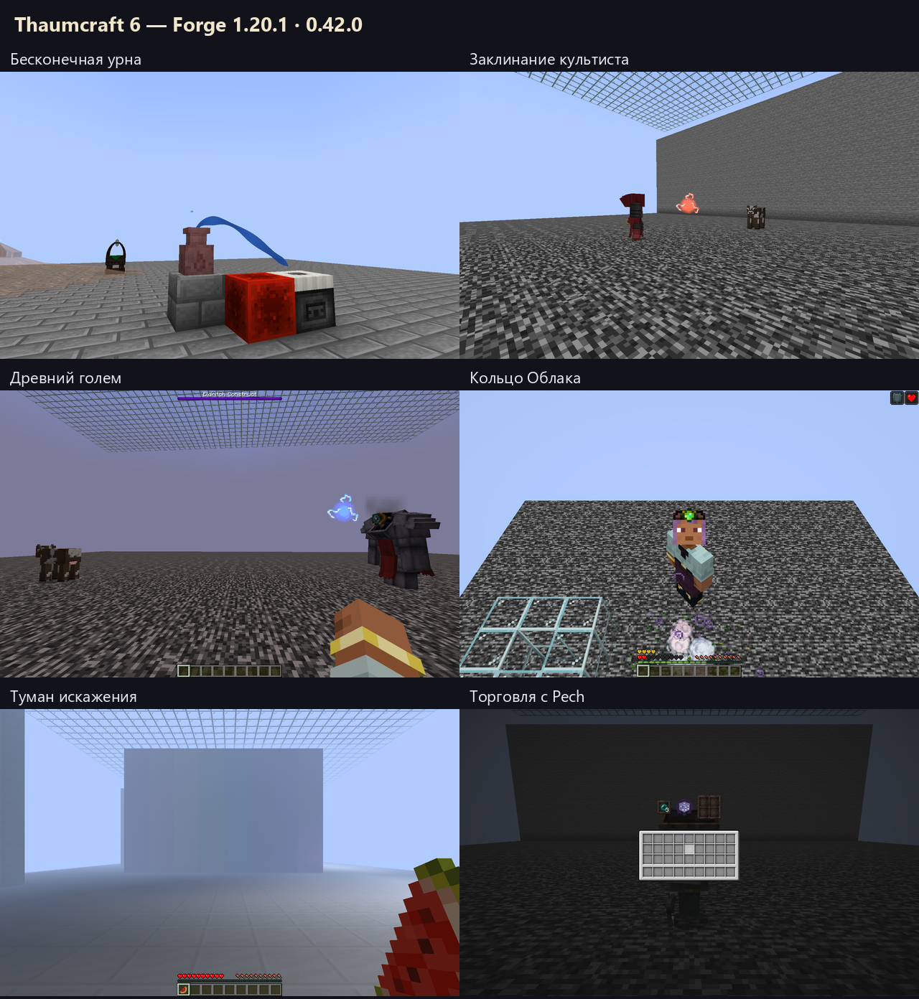

# Thaumcraft 6 — Forge 1.20.1

Неофициальный перенос **Thaumcraft 6.1.BETA26** с Minecraft 1.12.2.
Платформа: **Minecraft 1.20.1 / Forge 47.4.10 / Java 17**.
Текущая версия — **0.42.0**.

Подключены **148/148 канонических исследований** и **56/56 рецептов наполнения**.
Это охват реализованных путей прогрессии, а не процент готовности всего мода
и не подтверждение полного прохождения выживания.



## Установка

1. Установите Minecraft **1.20.1**, Forge **47.4.10** и **Java 17**.
2. Скопируйте в папку `mods` эти три файла:

```text
thaumcraft-1.20.1-0.42.0.jar
TerraBlender-forge-1.20.1-3.0.1.10.jar
curios-forge-5.14.1+1.20.1.jar
```

3. Запустите профиль Forge. В установочном архиве зависимости уже собраны вместе.

Порядок открытия знаний, требования и рецепты находятся в Таумономиконе.
Магический лес и ресурсы мира появляются при генерации новых чанков.

## Что реализовано

| Система | Содержимое |
| --- | --- |
| Исследования | Последовательное открытие Таумономикона, наблюдения и теории, карточки и помощники исследовательского стола, проверки требований и оплаты. |
| Ауромантия | Все 21 типа узлов фокусов, фокальный манипулятор, редактор заклинаний, продвинутые и великие фокусы. |
| Алхимия и наполнение | Тигель, производство и транспорт эссенции, банки, центрифуга, Тауматорий, алтарь и улучшения наполнением. |
| Големы | Изготовление и размещение, свойства и серверный AI, все 16 печатей, настройки и логистика. |
| Мир и порча | Аура, Vis и Flux, разломы, исходные биомы и растения, конечная Flux Goo, Bottle of Taint, заражённые существа и чемпионы. |
| Искажение | События Warp, болезни и их устранение, личный туман, исходные цветовые эффекты и размытие. |
| Существа | Торговля и поведение Pech, Firebat, Crimson Cultists и Crimson Rites, заражённые зомби, Eldritch-существа, порталы и боссы. |
| Поздняя прогрессия | Пустотная металлургия, Void Siphon, Voidseer, пустотное снаряжение и материалы големов. |
| Устройства | Турели, магический бур, зеркала, адская печь, конденсатор, лампы, генератор, зарядник верстака, Spa, бездонная урна, распылитель и магическая брусчатка. |
| Снаряжение | Исходные свойства брони и инструментов, рунический щит, сумка фокусов, Curios-слоты, Verdant Charms, Curiosity Band, Charm of Undying и Cloud Ring. |

Не завершённая в BETA26 цепочка Outer Lands остаётся неактивной.
Подземелья и измерения по механикам TC4 не добавляются вместо исходного TC6.
Современные адаптации API и подтверждённые ограничения описаны в аудитах.

## Проверки и границы

Серверные проверки: **1786/1786 — пройдены, native/Gradle exit 0**.
Клиентские проверки: **5 профилей / 87 полных PNG**.
Каждый выбранный полный кадр просмотрен основным и независимым проверяющим.
Скриншоты поставляются отдельным архивом рядом со сборкой; превью показано выше.

Клиент устройств и финальный сервер используют одинаковые 4817 отпечатков
исходников и ресурсов. У остальных четырёх клиентов сохранены точные
исключения для неактивных в их сценариях веток и проверочного кода:
[доказательство источников](validation/artifact-report-0.42.json).

Проверки используют явно подготовленные знания, материалы, ауру и площадки.
Они не заменяют длительное выживание, обычный многопользовательский сервер,
проверку звука, всех ракурсов и совместимости со сторонними модами.
Подробные результаты и оставшиеся ограничения — [VALIDATION.md](VALIDATION.md).

## Сборка из исходников

Нужны JDK **17** и интернет для первого получения зависимостей.
Gradle Wrapper включён в репозиторий.

```sh
./gradlew build
```

В Windows: `.\gradlew.bat build`.
Результат: `build/libs/thaumcraft-1.20.1-0.42.0.jar`.

## Документация

- [Таумономикон](THAUMONOMICON.md) и [таумометр](THAUMOMETER.md).
- [Эссенция](ESSENTIA.md), [наполнение](INFUSION.md), [ауромантия](AUROMANCY.md).
- [Големы и печати](GOLEMANCY.md), [биомы](BIOMES.md).
- [Снаряжение](EQUIPMENT.md), [аксессуары](ACCESSORIES.md), [улучшения](UPGRADES.md).
- [Источники и аудиты BETA26](docs/tc6/README.md).

## Происхождение

Оригинальный Thaumcraft — **Azanor**. Основа поведения: официальный `Thaumcraft-1.12.2-6.1.BETA26.jar`; закреплённые исходники: [TheDarkTower314/Thaumcraft-6-Source-Code](https://github.com/TheDarkTower314/Thaumcraft-6-Source-Code/tree/954022bb777b7546281fb36df8522f0ba6b43f81), коммит `954022bb777b7546281fb36df8522f0ba6b43f81`. SHA-256 и проверенные справочники — [reference-manifest.json](docs/tc6/reference-manifest.json).

Это не официальный релиз Azanor. Общая лицензия всего upstream-проекта в его корне не найдена; перенос не меняет права на исходный код и ресурсы. Лицензия переводов сохранена в [notices/translations-LICENSE](notices/translations-LICENSE). [База знаний](docs/tc6/README.md) отделяет подтверждённое поведение BETA26 от декомпиляции, справочников и адаптаций переноса.
