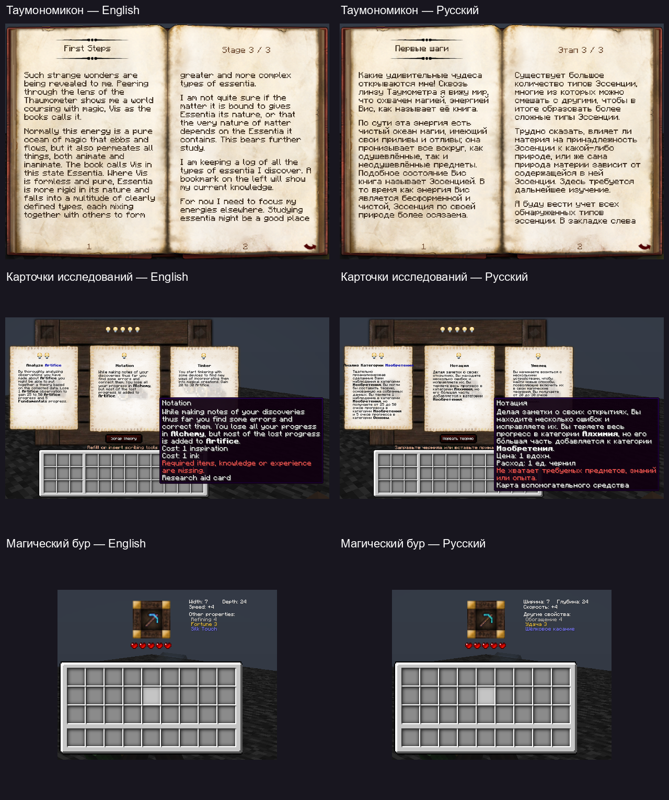

# Thaumcraft 6 — Forge 1.20.1

[Русский](#russian) · [English](#english) · [Последний релиз / Latest release](https://github.com/DJDMM/Thaumcraft-6-1.20.1-port/releases/latest)

**0.42.1** · **Minecraft 1.20.1** · **Forge 47.4.10** · **Java 17**



<a id="russian"></a>

## Русский

Неофициальный перенос **Thaumcraft 6.1.BETA26** с Minecraft 1.12.2 на Forge 1.20.1.
Исследуйте аспекты, открывайте знания в Таумономиконе, создавайте магические
инструменты, работайте с эссенцией и стройте големов.

Текущая версия — **0.42.1**. Подключены **148/148 канонических исследований**
и **56/56 рецептов наполнения**. Эти числа описывают охват реализации;
они не означают, что весь мод полностью проверен в выживании.

### Скачать

- [Сборка с зависимостями](https://github.com/DJDMM/Thaumcraft-6-1.20.1-port/releases/download/v0.42.1/thaumcraft-1.20.1-0.42.1-mods.zip) — готовый набор трёх JAR для папки `mods`.
- [Только Thaumcraft](https://github.com/DJDMM/Thaumcraft-6-1.20.1-port/releases/download/v0.42.1/thaumcraft-1.20.1-0.42.1.jar) — зависимости устанавливаются отдельно.
- [Игровые скриншоты](https://github.com/DJDMM/Thaumcraft-6-1.20.1-port/releases/download/v0.42.1/thaumcraft-1.20.1-0.42.1-screenshots.zip) — 10 кадров русского и английского интерфейсов.
- [Страница релиза 0.42.1](https://github.com/DJDMM/Thaumcraft-6-1.20.1-port/releases/tag/v0.42.1).

### Установка

1. Установите **Minecraft 1.20.1**, **Forge 47.4.10** и **Java 17**.
2. Выделите игре **4096 МБ (4 ГБ) оперативной памяти** в настройках лаунчера.
3. Распакуйте установочный архив и поместите эти три файла в папку `mods`:

```text
thaumcraft-1.20.1-0.42.1.jar
TerraBlender-forge-1.20.1-3.0.1.10.jar
curios-forge-5.14.1+1.20.1.jar
```

4. Запустите профиль Forge. При обновлении замените старый JAR Thaumcraft новым.

**TerraBlender** нужен для генерации биомов, **Curios** — для слотов аксессуаров.
Обе зависимости входят в установочный архив. Магический лес и ресурсы мира
появляются при генерации новых чанков. Требования, рецепты и порядок открытия
знаний находятся в Таумономиконе.

### Языки

Мод поддерживает **Русский (Россия)** и **English (US)** и следует языку Minecraft.
Названия, исследования, карточки, подсказки и сообщения взяты из исходных
языковых файлов выпущенного TC6 BETA26. Пропуски русского оригинала дополнены
по его английскому тексту. В каждой локали **2249 ключей**.

### Содержимое

| Система | Что перенесено |
| --- | --- |
| Исследования | Таумономикон с последовательным открытием знаний, наблюдения и теории, карточки и помощники стола исследований, требования и оплата. |
| Ауромантия | Все 21 типа узлов фокусов, фокальный манипулятор, редактор заклинаний, продвинутые и великие фокусы. |
| Алхимия и наполнение | Тигель, производство и транспорт эссенции, банки, центрифуга, Тауматорий, алтарь и улучшения наполнением. |
| Големы | Изготовление, размещение, свойства и поведение, все 16 печатей, настройки и логистика. |
| Мир и порча | Аура, Vis и Flux, разломы, исходные биомы и растения, Flux Goo, Bottle of Taint, заражённые существа и чемпионы. |
| Искажение | События Warp, болезни и их устранение, личный туман и исходные цветовые эффекты. |
| Существа | Торговля Pech, Firebat, Crimson Cultists и Crimson Rites, заражённые зомби, Eldritch-существа, порталы и боссы. |
| Поздняя прогрессия | Пустотная металлургия, Void Siphon, Voidseer, пустотное снаряжение и материалы големов. |
| Устройства | Турели, бур, зеркала, адская печь, конденсатор, лампы, генератор, зарядник верстака, Spa, бездонная урна, распылитель и магическая брусчатка. |
| Снаряжение | Исходные свойства брони и инструментов, рунический щит, сумка фокусов, аксессуары Curios, Verdant Charms, Curiosity Band, Charm of Undying и Cloud Ring. |

Цепочка Outer Lands остаётся неактивной, как в выпущенном BETA26.
Адаптации современных API и границы переноса описаны в документации.

### Проверки

- **0.42.1:** сборка и проверка обоих языков в настоящем клиенте прошли. Проверены имена зарегистрированных предметов, блоков, сущностей, эффектов и атрибутов, все 33 карточки и 121 вариант предметов с подсказками. Все 10 полных кадров, обзорный лист и превью просмотрены двумя проверяющими.
- **База 0.42.0:** пройдены **1786/1786 серверных проверок**, проверены пять клиентских сценариев и 87 полных кадров. Серверный набор не запускался повторно для патча локализации 0.42.1.

Проверки используют подготовленные знания, материалы и площадки. Полное
прохождение выживания, обычный многопользовательский сервер, звук, все ракурсы
и совместимость со сторонними модами пока не подтверждены.
[Результаты и ограничения](VALIDATION.md), [отчёт 0.42.1](validation/artifact-report-0.42.1.json).

### Сборка из исходников

Нужны JDK **17** и интернет для первого получения зависимостей. Gradle Wrapper включён.

```sh
./gradlew build
```

В Windows: `.\gradlew.bat build`. Результат: `build/libs/thaumcraft-1.20.1-0.42.1.jar`.

### Документация и происхождение

- [Таумономикон](THAUMONOMICON.md), [таумометр](THAUMOMETER.md), [исследования](RESEARCH-PROGRESSION.md).
- [Эссенция](ESSENTIA.md), [наполнение](INFUSION.md), [ауромантия](AUROMANCY.md).
- [Големы](GOLEMANCY.md), [биомы](BIOMES.md), [снаряжение](EQUIPMENT.md), [аксессуары](ACCESSORIES.md), [улучшения](UPGRADES.md).
- [Источники и аудиты BETA26](docs/tc6/README.md), [локализация RU/EN](docs/tc6/LOCALIZATION-BETA26-AUDIT.md).

Оригинальный Thaumcraft создан **Azanor**. Основа поведения — выпущенный
`Thaumcraft-1.12.2-6.1.BETA26.jar`; закреплённые исходники —
[TheDarkTower314/Thaumcraft-6-Source-Code](https://github.com/TheDarkTower314/Thaumcraft-6-Source-Code/tree/954022bb777b7546281fb36df8522f0ba6b43f81),
коммит `954022bb777b7546281fb36df8522f0ba6b43f81`.
Хеши и проверенные источники находятся в [reference-manifest.json](docs/tc6/reference-manifest.json).

Это не официальный релиз Azanor. Общая лицензия всего upstream-проекта в его
корне не найдена; перенос не меняет права на исходный код и ресурсы.
Лицензия переводов сохранена в [notices/translations-LICENSE](notices/translations-LICENSE).

<a id="english"></a>

## English

An unofficial port of **Thaumcraft 6.1.BETA26** from Minecraft 1.12.2 to Forge 1.20.1.
Discover aspects, unlock knowledge in the Thaumonomicon, craft magical tools,
work with essentia and build golems.

The current version is **0.42.1**. It implements **148/148 canonical research entries**
and **56/56 infusion recipes**. These counts describe implementation coverage;
they do not mean that the entire mod has been verified through a survival playthrough.

### Downloads

- [Mod bundle with dependencies](https://github.com/DJDMM/Thaumcraft-6-1.20.1-port/releases/download/v0.42.1/thaumcraft-1.20.1-0.42.1-mods.zip) — all three JARs for your `mods` folder.
- [Thaumcraft JAR only](https://github.com/DJDMM/Thaumcraft-6-1.20.1-port/releases/download/v0.42.1/thaumcraft-1.20.1-0.42.1.jar) — install the dependencies separately.
- [Gameplay screenshots](https://github.com/DJDMM/Thaumcraft-6-1.20.1-port/releases/download/v0.42.1/thaumcraft-1.20.1-0.42.1-screenshots.zip) — 10 captures of the Russian and English interfaces.
- [Release 0.42.1](https://github.com/DJDMM/Thaumcraft-6-1.20.1-port/releases/tag/v0.42.1).

### Installation

1. Install **Minecraft 1.20.1**, **Forge 47.4.10** and **Java 17**.
2. Allocate **4096 MB (4 GB) of RAM** to the game in your launcher settings.
3. Extract the mod bundle and place these three files in your `mods` folder:

```text
thaumcraft-1.20.1-0.42.1.jar
TerraBlender-forge-1.20.1-3.0.1.10.jar
curios-forge-5.14.1+1.20.1.jar
```

4. Start the Forge profile. When updating, replace the old Thaumcraft JAR with the new one.

**TerraBlender** provides biome generation, and **Curios** provides accessory slots.
Both dependencies are included in the bundle. Magical Forest and world resources
generate in new chunks. Research requirements, recipes and the order of discoveries
are available in the Thaumonomicon.

### Languages

The mod supports **Русский (Россия)** and **English (US)** and follows Minecraft's language setting.
Names, research, cards, tooltips and messages come from the language files of the
released TC6 BETA26. Missing Russian passages are translated from its English text.
Each locale contains **2249 keys**.

### Features

| System | Ported content |
| --- | --- |
| Research | The Thaumonomicon with progressive discoveries, observations and theories, research table cards and aids, requirements and payment. |
| Auromancy | All 21 focus node types, the Focal Manipulator, spell editing, advanced and greater foci. |
| Alchemy and infusion | The Crucible, essentia production and transport, jars, the centrifuge, Thaumatorium, infusion altar and infusion upgrades. |
| Golems | Crafting, placement, properties and behaviour, all 16 seals, configuration and logistics. |
| World and taint | Aura, Vis and Flux, rifts, original biomes and plants, Flux Goo, Bottle of Taint, tainted creatures and champions. |
| Warp | Warp events, afflictions and cures, private mist and original colour effects. |
| Creatures | Pech trading, Firebat, Crimson Cultists and Crimson Rites, tainted zombies, Eldritch creatures, portals and bosses. |
| Late progression | Void metallurgy, Void Siphon, Voidseer, void equipment and golem materials. |
| Devices | Turrets, the Arcane Bore, mirrors, Infernal Furnace, condenser, lamps, generator, Workbench Charger, Spa, Everfull Urn, Potion Sprayer and magical paving stones. |
| Equipment | Original armour and tool properties, runic shielding, Focus Pouch, Curios accessories, Verdant Charms, Curiosity Band, Charm of Undying and Cloud Ring. |

The Outer Lands chain remains inactive, as it was in the released BETA26.
Modern API adaptations and the scope of the port are documented in the audits.

### Validation

- **0.42.1:** the build and native client checks passed for both languages. Checks cover registered item, block, entity, effect and attribute names, all 33 cards and 121 item/tooltip variants. Two reviewers inspected all 10 full captures, the contact sheet and the preview.
- **0.42.0 baseline:** **1786/1786 server checks** passed, with five client scenarios and 87 full captures reviewed. That server suite was not rerun for the 0.42.1 localization patch.

Checks use prepared knowledge, materials and arenas. A full survival playthrough,
ordinary multiplayer, audio, every viewing angle and compatibility with third-party
mods have not yet been verified.
[Results and limitations](VALIDATION.md), [0.42.1 report](validation/artifact-report-0.42.1.json).

### Building from source

Use JDK **17**. Internet access is needed for the initial dependency download. The Gradle Wrapper is included.

```sh
./gradlew build
```

On Windows: `.\gradlew.bat build`. Output: `build/libs/thaumcraft-1.20.1-0.42.1.jar`.

### Documentation and provenance

- [Thaumonomicon](THAUMONOMICON.md), [Thaumometer](THAUMOMETER.md), [research progression](RESEARCH-PROGRESSION.md).
- [Essentia](ESSENTIA.md), [infusion](INFUSION.md), [auromancy](AUROMANCY.md).
- [Golems](GOLEMANCY.md), [biomes](BIOMES.md), [equipment](EQUIPMENT.md), [accessories](ACCESSORIES.md), [upgrades](UPGRADES.md).
- [BETA26 sources and audits](docs/tc6/README.md), [Russian/English localization](docs/tc6/LOCALIZATION-BETA26-AUDIT.md).

The original Thaumcraft was created by **Azanor**. Behaviour is based on the released
`Thaumcraft-1.12.2-6.1.BETA26.jar`; the pinned source reference is
[TheDarkTower314/Thaumcraft-6-Source-Code](https://github.com/TheDarkTower314/Thaumcraft-6-Source-Code/tree/954022bb777b7546281fb36df8522f0ba6b43f81),
commit `954022bb777b7546281fb36df8522f0ba6b43f81`.
Hashes and verified references are recorded in [reference-manifest.json](docs/tc6/reference-manifest.json).

This is not an official Azanor release. No project-wide upstream licence was found
in its root; this port does not change ownership of the original code or assets.
The translation licence is preserved in [notices/translations-LICENSE](notices/translations-LICENSE).
